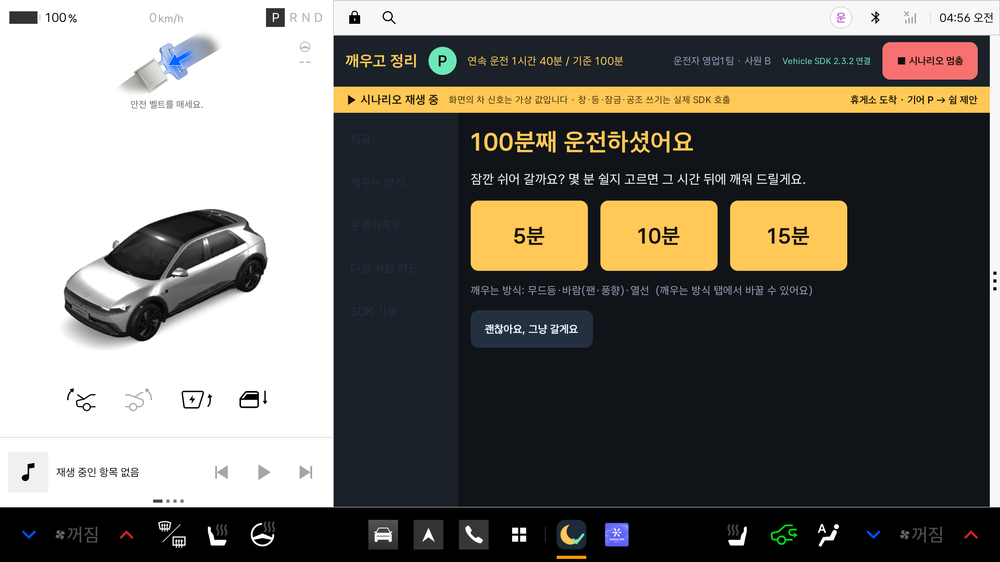
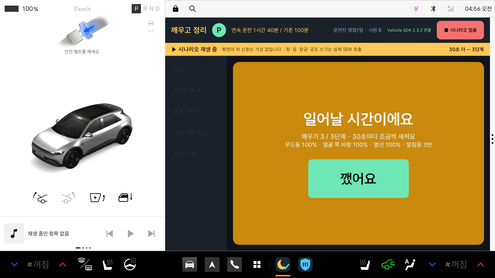
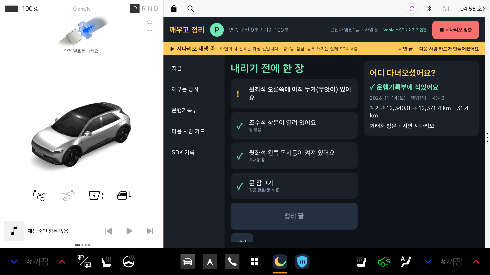
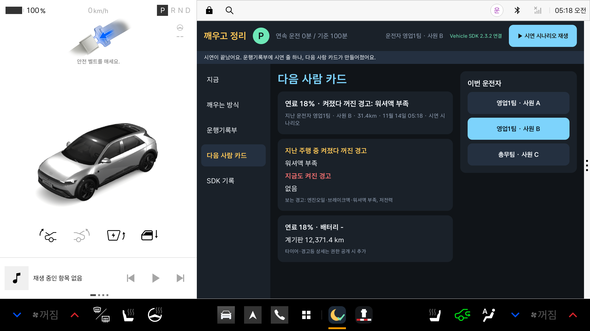

# 깨우고 정리 (wake-and-tidy)

**쉴 땐 내가 고른 방식으로 깨워 주고, 내릴 땐 창문·독서등·잠금을 한 번에 정리하고, 법인 공용차라면 운행기록부 한 줄과 '다음 사람 카드'를 남기는 Pleos Connect 차량 앱.**

- 패키지: `com.moyeon.waketidy` · 앱 이름 표시: 깨우고 정리
- Pleos Vehicle SDK 2.3.2 · Kotlin 2.0.0 · Jetpack Compose · AGP 8.8.2 · Gradle 8.10.2

## 무엇을 하나

| 장면 | 하는 일 |
|---|---|
| 쉴 때 | 연속 운전이 기준(기본 100분, 설정에서 1분 시연용·30·60·100·120분)을 넘긴 뒤 **P단에 서면** 쉼을 제안 → 5/10/15분 중 고름 → 시간이 되면 **내가 고른 방식**(무드등·독서등·바람(팬·풍향)·열선·통풍)으로 30초마다 한 단계씩, 3단계까지 세게 깨움(2단계부터 알림음) → "깼어요" → 2분 회복 화면 → 출발. 깨우는 방식은 프로필로 저장, 깨우기 기록은 앱 안에만 저장. |
| 내릴 때 | **P단 + 운전석 문 열림** → 뒷좌석 착석·열린 창문·켜진 독서등·잠금 상태를 한 장 카드로 → "한 번에 정리"로 창 닫기·독서등 끄기·문 잠금을 실제 SDK 로 씀. |
| 다음 사람 카드 (법인 공용차) | 주행 시작(P 에서 처음 D·R 로 바뀔 때) 계기판 누적 거리(`Odometer.getCurrentDistanceDriven`)를 적고, 내릴 때 목적 한 탭(거래처 방문 / 출퇴근 / 개인 + 최근 3개)으로 **운행기록부 한 줄**을 만듦. 업무용승용차 운행기록부 서식 열 이름을 따른 CSV 를 앱 저장소에 저장하고 화면 표로 보여 줌. 다음 운전자에게는 공개 경고 신호(엔진오일·브레이크액·워셔액 부족, 저전력) 중 지난 주행 중 켜졌다 꺼진 것과 지금 켜진 것, 연료·배터리 잔량, 계기판 거리 카드. 타이어·경고등 상세는 해당 권한이 공개되면 추가합니다. **위치·경로는 저장하지 않음**(SDK 에도 없음). |

주행 중(기어 ≠ P)에는 화면 조작을 잠그고 큰 글씨 상태만 보여 줍니다.

## 실행 방법

```sh
# 설치
adb install -r apk/모연_깨우고정리_release.apk
# 실행
adb shell am start -n com.moyeon.waketidy/.MainActivity
```

### 시연 시나리오 (30초)
화면 오른쪽 위 **"▶ 시연 시나리오 재생"** 버튼(또는 아래 명령)을 누르면, 에뮬레이터 VHAL 패널을 만지지 않고도 같은 판정 엔진에 가상 신호를 흘려 아래 흐름을 재현합니다.

```sh
adb shell am start -n com.moyeon.waketidy/.MainActivity --ez demo true
```

출발(P→D, 계기판 12,340.0km) → 연속 운전 100분(가상 시간) → P단 쉼 제안 → 10분 선택 → 1·2·3단계 깨우기 → "깼어요" → 2분 회복 → 운전석 문 열림 → 원탭 정리 → 목적 "거래처 방문" → 운행기록부 한 줄(31.4km) → 다음 사람 카드.

- 재생 중에는 화면 위에 노란 **"시나리오 재생 중"** 띠가 떠서 실제 신호와 구분됩니다. 화면의 차 신호(기어·문·창·경고·잔량)는 가상 값입니다.
- **차량 쓰기(무드등·독서등·팬·열선·창 닫기·문 잠금)는 시나리오 중에도 실제 SDK 를 호출**합니다. 결과는 "SDK 기록" 탭과 logcat(`WakeTidy` 태그)에 남습니다.
- 시나리오가 만든 운행기록부 줄은 비고에 "시연 시나리오"로 표시되고 "시연 줄 지우기"로 지울 수 있습니다.

## 테스트 환경 · 필요 설정

| 항목 | 값 |
|---|---|
| 에뮬레이터 | `Pleos_Connect_v2.1.0_API_34` (Android 14, API 34) |
| Vehicle SDK | `ai.pleos.playground:Vehicle:2.3.2` (nexus-playground maven) |
| 화면 규격 | `adb shell wm size` → 2560x1440, `wm density` → 160. 앱은 가로 고정 |
| minSdk / targetSdk | 28 / 35 |
| 빌드 JDK | 17 (`JAVA_HOME=/opt/homebrew/opt/openjdk@17/...`) |

### 쓰는 권한 (`AndroidManifest.xml`)
- 읽기: `android.car.permission.CAR_POWERTRAIN`(기어, AAOS 표준), `pleos.car.permission.CAR_DRIVE`(계기판 거리 — 빼면 `getCurrentDistanceDriven need Permission`), `CAR_DOORS`, `CAR_WINDOWS`, `CAR_LIGHTS`, `CAR_SEATS`, `CAR_MILEAGE`(계기판 거리), `CAR_SAFETY`(공개 경고 신호), `CAR_ENERGY`(연료·배터리), `CAR_CLIMATE`
- 쓰기: `pleos.car.permission.CONTROL_CAR_WINDOWS`, `CONTROL_CAR_DOORS`, `CONTROL_CAR_LIGHTS`, `CONTROL_CAR_CLIMATE`, `CONTROL_CAR_SEATS`

### 빌드

```sh
export JAVA_HOME=/opt/homebrew/opt/openjdk@17/libexec/openjdk.jdk/Contents/Home
sh ./gradlew test             # 판정 엔진 JUnit
sh ./gradlew assembleRelease  # ../keystore/keystore.properties 가 있으면 서명, 없으면 서명 없이
```
`local.properties`(sdk.dir)와 서명 키·비밀번호는 저장소에 넣지 않습니다.

## APK 위치
`apk/모연_깨우고정리_release.apk` (release, 서명됨, minify 끔)

## 구조

```
app/src/main/java/com/moyeon/waketidy/
  engine/   ← Android 의존 없는 순수 Kotlin 판정 엔진 (JUnit: app/src/test)
    DrivingTimer   연속 운전 시간 누적, P단 쉼 제안 조건
    RestFlow       제안 → 쉼 → 깨우기(단계) → 2분 회복 상태 기계
    WakeSchedule   깨우는 방식별 3단계 동작(점점 세짐)
    Tidy           하차 감지(P + 운전석 문), 정리 항목 산출
    Logbook        주행 시작·끝 계기판 거리 → 운행기록부 한 줄, CSV
    Handover       켜졌다 꺼진 경고 추적, 다음 사람 카드
    DemoScenario   30초 시연용 가상 신호 스크립트
    WakeTidyEngine 위를 묶는 입구(실제 신호와 가상 신호가 같은 입구로 들어옴)
  vehicle/VehicleGateway  ← 실제 Pleos Vehicle SDK 호출(전용 스레드), 실패는 기록만 하고 화면은 유지
  data/Store              ← 프로필·깨우기 기록·운행기록부·카드 로컬 저장, CSV 파일 쓰기
  AppController, ui/      ← Compose 화면
```

## 사용한 Pleos SDK API

| 기능 | API |
|---|---|
| SDK 연결 | `Vehicle(context).initialize()` / `release()` |
| 주행 중 판단, 주행 시작 | AAOS 표준 `CarPropertyManager` 의 `VehiclePropertyIds.GEAR_SELECTION` (`getIntProperty` + `registerCallback`). Gear 도메인 deprecated → AAOS 표준 GEAR_SELECTION (SDK 2.3.2 `Vehicle.getGear()` 는 `@Deprecated`, 공개 문서 19개 도메인에 없음) |
| 하차 감지 | `Door.getCurrentDoorPosition(ROW_1_LEFT)`, `Door.registerDoorPosition` |
| 잠금 상태·문 잠그기 | `Door.checkDoorLockCapabilities`, `Door.getDoorLockState`, `Door.registerDoorLockState`, `Door.setDoorLock` |
| 열린 창문·창 닫기 | `Window.getCurrentWindowPosition`, `Window.registerWindowPosition`, `Window.checkWindowPositionCapabilities`, `Window.setWindowPosition` |
| 켜진 독서등·끄기, 깨우기 빛 | `Light.getCurrentReadingLightState`, `Light.registerReadingLightState`, `Light.setReadingLightSwitch` |
| 깨우기: 무드등 | `Light.checkAmbientLightBrightnessCapabilities`, `Light.getAmbientLightBrightness`, `Light.setAmbientLightSwitch`, `Light.setAmbientLightBrightness` |
| 깨우기: 바람 | `HVAC.checkHvacPowerCapabilities`, `HVAC.checkHvacFanSpeedCapabilities`, `HVAC.getHvacPowerState`, `HVAC.setHvacPower`, `HVAC.getHvacAutoState`, `HVAC.setHvacAuto`, `HVAC.getHvacFanSpeed`, `HVAC.setHvacFanSpeed`, `HVAC.getHvacFanDirection`, `HVAC.setHvacFanDirection` |
| 깨우기: 열선·통풍 | `Seat.checkSeatTemperatureCapabilities`, `Seat.setHvacSeatTemperature`, `Seat.checkSeatVentilationCapabilities`, `Seat.setHvacSeatVentilation` |
| 뒷좌석 남음 | `Seat.getCurrentSeatOccupancy(ROW_2_*)`, `Seat.registerSeatOccupancy` |
| 운행기록부 계기판 거리 | `Odometer.getCurrentDistanceDriven` |
| 다음 사람 카드: 경고(공개 신호만) | `Safety.getEngineOilLevelState`, `Safety.getBrakeFluidLevelState`, `Safety.hasLowWasherFluidWarning`, `Safety.hasPowerDownWarningIndicator` (+ 각 register) |
| 다음 사람 카드: 계기판 거리 | `Odometer.getCurrentDistanceDriven` (운행기록부와 같은 값) |
| 다음 사람 카드: 잔량 | `Fuel.getFuelPercent`, `Fuel.registerFuelPercent`, `EvBattery.getEvBatteryStateOfCharge`, `EvBattery.registerEvBatteryStateOfCharge` |
| 알림음 | Android `ToneGenerator` (Pleos TTS 대신) |

### 에뮬레이터에서 확인한 결과
- 동작함: 기어(AAOS `GEAR_SELECTION`, 시작 시 `GEAR_PARK(4)` 받음)·운전석 문·창 4개·독서등 4자리·뒷좌석 착석 읽기/구독, 문 잠금(4개 문 묶음 영역), 창 닫기, 독서등 끄기, 무드등 켜기·밝기, 운전석 열선, 계기판 거리 읽기(에뮬레이터 값 0.0), EV 배터리 잔량(100%).
- 동작 안 함(오류를 SDK 기록 탭에 남기고 계속 동작):
  - `Safety.getEngineOilLevelState`, `getBrakeFluidLevelState`, `hasLowWasherFluidWarning`, `Fuel.getFuelPercent` → 이 에뮬레이터 VHAL 에 해당 속성이 없음(`not in carPropertyConfig`).
  - `HVAC.setHvacFanSpeed`/`setHvacFanDirection` → `PropertyAsyncError error code 2`. `setHvacPower(true)` 와 AUTO 확인 뒤에도 같은 결과라 원인 미확인.
  - 운전석 단독 영역의 `Door.getDoorLockState(ROW_1_LEFT)` 는 미지원 → `checkDoorLockCapabilities` 로 찾은 묶음 영역을 씁니다.
- 쓰지 않는 API: `Safety.getTelltalesInfo`/`registerTelltales`, `Tire.getTirePressure`/`registerTirePressure` 는 SDK 안에서 `PRIVATE_CAR_SAFETY` 권한을 요구해(`SecurityException`) 공식 샘플 앱도 막아 두었습니다. 이 앱은 이 API 들을 호출하지 않고, 비공개 권한도 매니페스트에 넣지 않습니다.
- 앱이 뒤로 밀려 있을 때(같은 에뮬레이터에 다른 앱이 앞에 있을 때) 프로세스가 멈췄다가 다시 앞으로 오면 이어서 진행했고, 그 직후 쓰기 몇 건이 `50001`/`30001` 오류로 실패한 적이 있습니다. 앱이 앞에 있을 때는 같은 쓰기가 모두 성공했습니다.

## 화면

| 쉼 제안 | 깨우기 3단계 |
|---|---|
|  |  |
| **내릴 때 한 장 + 운행기록부** | **다음 사람 카드** |
|  |  |

(스크린샷은 시연 시나리오 재생 중/직후 화면입니다. 차 신호는 가상 값입니다. 다음 사람 카드의 가상 값은 워셔액 부족 경고(주행 중 켜졌다 꺼짐)와 연료 18% 입니다.)

## 알려진 한계
- 실제 차의 무드등·팬 값 범위, 계기판 거리 단위(km 로 가정)는 실차에서 확인이 필요합니다.
- 다음 사람 카드는 공개 경고 신호 4가지와 잔량·계기판 거리만 봅니다. 타이어 공기압·경고등 상세는 권한이 공개되면 추가할 수 있습니다. 이 에뮬레이터에는 엔진오일·브레이크액·워셔액·연료 속성이 없어 실제 값은 실차에서 확인이 필요합니다.
- 운전자 선택은 화면의 사원 버튼(예시 3명)입니다. 사원 등록·관리자 화면은 없습니다.
- 운행기록부 CSV 열 이름은 업무용승용차 운행기록부 서식을 따랐지만 고시 원문과 한 번 더 대조가 필요합니다.
